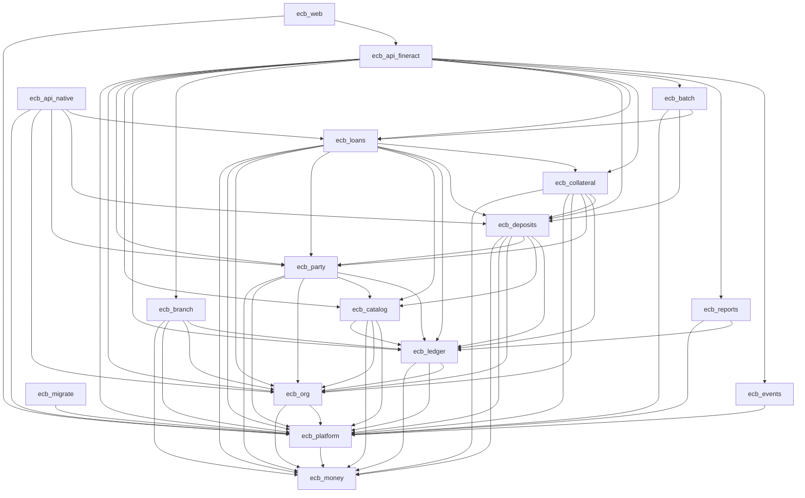

# E-CoreBank module documents

One design document per module, aligned with Apache Fineract 1.16.1. Generated by `python parity/tools/module_docs.py build` from
`modules.json` (design, hand-written) and the `parity/` inventories (facts). See the [design reference](../design/00-fineract-design-reference.md).

| Module | Title | Phase | Depends on | Operations (must / should / defer) | Tables | Fineract Java files | Test classes |
|---|---|---:|---|---|---:|---:|---:|
| [ecb_money](ecb_money.md) | Money, currency and calculation primitives | 1 | none | 0 / 0 / 0 | 0 | 30 | 0 |
| [ecb_platform](ecb_platform.md) | Platform: tenancy, security, commands, audit, business date | 1 | ecb_money | 64 / 29 / 0 | 22 | 1082 | 21 |
| [ecb_ledger](ecb_ledger.md) | General ledger and accounting | 3 | ecb_money, ecb_platform, ecb_org | 49 / 0 / 0 | 15 | 272 | 9 |
| [ecb_branch](ecb_branch.md) | Branch cash: tellers and cashiers | 3 | ecb_money, ecb_platform, ecb_org, ecb_ledger | 16 / 4 / 0 | 4 | 51 | 2 |
| [ecb_org](ecb_org.md) | Organisation and reference data | 2 | ecb_money, ecb_platform | 72 / 4 / 0 | 25 | 334 | 22 |
| [ecb_party](ecb_party.md) | Clients: the customer master | 2 | ecb_money, ecb_platform, ecb_org, ecb_catalog, ecb_ledger | 52 / 0 / 0 | 12 | 182 | 15 |
| [ecb_catalog](ecb_catalog.md) | Catalog: charges, taxes, rates, interest-rate charts | 2 | ecb_ledger, ecb_money, ecb_org, ecb_platform | 32 / 4 / 0 | 11 | 212 | 8 |
| [ecb_deposits](ecb_deposits.md) | Deposits: savings, current, fixed and recurring | 3 | ecb_money, ecb_platform, ecb_org, ecb_party, ecb_catalog, ecb_ledger | 109 / 0 / 0 | 22 | 426 | 24 |
| [ecb_loans](ecb_loans.md) | Loans: products, schedules, accounts and transactions | 4 | ecb_money, ecb_platform, ecb_org, ecb_party, ecb_catalog, ecb_ledger, ecb_deposits, ecb_collateral | 92 / 185 / 0 | 90 | 1307 | 247 |
| [ecb_collateral](ecb_collateral.md) | Collateral and guarantors | 4 | ecb_money, ecb_platform, ecb_org, ecb_party, ecb_ledger, ecb_deposits | 23 / 6 / 0 | 7 | 87 | 0 |
| [ecb_batch](ecb_batch.md) | Batch: scheduler, close of business, locks | 5 | ecb_platform, ecb_deposits, ecb_loans | 18 / 4 / 0 | 13 | 347 | 3 |
| [ecb_reports](ecb_reports.md) | Reports and exports | 5 | ecb_platform, ecb_ledger | 8 / 7 / 0 | 7 | 46 | 3 |
| [ecb_events](ecb_events.md) | Business events, hooks, notifications | 6 | ecb_platform | 0 / 12 / 0 | 17 | 435 | 11 |
| [ecb_api_fineract](ecb_api_fineract.md) | Fineract-compatible REST API | 1 | ecb_platform, ecb_org, ecb_party, ecb_catalog, ecb_ledger, ecb_branch, ecb_deposits, ecb_loans, ecb_collateral, ecb_batch, ecb_reports, ecb_events | 0 / 0 / 0 | 0 | 2 | 0 |
| [ecb_api_native](ecb_api_native.md) | Native E-CoreBank API | 6 | ecb_platform, ecb_org, ecb_party, ecb_deposits, ecb_loans | 0 / 0 / 0 | 0 | 0 | 0 |
| [ecb_web](ecb_web.md) | LiveView console (the Mifos rewrite) | 2 | ecb_platform, ecb_api_fineract | 0 / 0 / 0 | 0 | 0 | 0 |
| [ecb_migrate](ecb_migrate.md) | Migration from an existing Fineract database | 7 | ecb_platform | 0 / 0 / 0 | 0 | 0 | 0 |
| [deferred](deferred.md) | Deferred features (not built in the first releases) | 8 | none | 0 / 0 / 158 | 35 | 664 | 22 |

## Dependency graph

Arrows point at what a module depends on. The graph must stay acyclic and is enforced with `mix xref`.

## Implementation order

1. ecb_money: pure, no dependencies, fully testable on its own. Currency, Money, rounding, day-count and interest arithmetic.
2. ecb_platform, part 1: command bus, command store and audit, idempotency, permissions with maker-checker, business date, configuration. The tenant registry already exists.
3. ecb_api_fineract skeleton: tenant header, basic authentication, `GET /offices`. The contract probe starts moving here.
4. ecb_org: offices, staff, currencies, codes, holidays, working days, payment types, funds. ecb_platform part 2: data tables.
5. ecb_party and ecb_catalog: clients, then charges, taxes, rates, interest-rate charts.
6. ecb_ledger: GL accounts, accounting rules, journal entries, closures; then ecb_branch (tellers and cashiers) if the pilot bank runs branches.
7. ecb_deposits: savings first, then fixed and recurring deposits, transfers, standing instructions.
8. ecb_loans: the pure schedule engine first, then products, accounts, transactions; ecb_collateral alongside.
9. ecb_batch: business-date roll, scheduler, loan and savings COB; ecb_reports; ecb_events.
10. ecb_web screens module by module as each API goes green; ecb_api_native; ecb_migrate; then the deferred features if the pilot bank asks for them.

## Coverage of Fineract's source

Every Java package of the Fineract 1.16.1 server source is claimed by exactly one module or deliberately excluded: **5480 of 5509 files claimed**, 29 excluded.

- Excluded `client`: Generated and hand-written Java SDK clients (fineract-client, fineract-client-feign). Not server code: E-CoreBank has no need for a Java client.
- Excluded `avro`: Avro schema generator tooling. The event schemas themselves are followed by ecb_events.

`python parity/tools/module_docs.py check` fails when a Fineract upgrade adds a package that no module claims.

## How the pieces fit

E-CoreBank is an Elixir umbrella of small apps with one-way dependencies. ecb_money and ecb_platform are the base. Reference data and the customer master (ecb_org, ecb_party, ecb_catalog) sit on them. ecb_ledger records money movements as Fineract-style journals, and ecb_branch handles teller cash on top of it. The product apps (ecb_deposits, ecb_loans, ecb_collateral) post to the ledger through the command bus. ecb_batch runs close of business, ecb_reports runs reports, ecb_events publishes business events. ecb_api_fineract exposes everything over the Fineract-compatible REST contract, ecb_api_native adds our own API later, and ecb_web is the LiveView console. ecb_migrate brings data in from an existing Fineract database. Features outside the approved scope are parked in the deferred document so nothing is lost.
